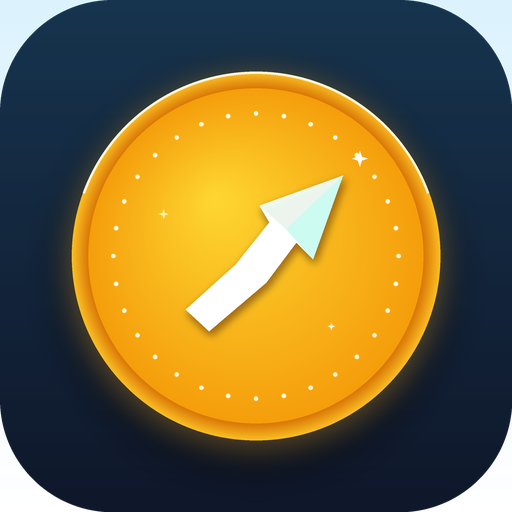

# Centsation

**Personal Savings & Goal Tracker**  
*Crafted with passion by [Az-har](https://github.com/Az-har)*

Centsation is a modern, privacy-first offline savings tracker designed to help you reach your financial milestones with zero fuss. Whether you're setting aside funds for a vacation, an emergency buffer, a vehicle, or a major purchase, Centsation keeps you focused, motivated, and in control.

---

## Highlights & Features

- **100% Offline & Private:** Your financial data stays strictly on your device. No analytics, no accounts, and no network tracking.
- **Persistent Auto-Backup:** Automatically creates and updates resilient backups in `Documents/Centsation` so your goals survive app reinstallation.
- **Material 3 Expressive UI:** Built with Material 3 design, dynamic wallpaper color palettes, smooth spring animations, and an interactive dashboard.
- **Deposit & Withdrawal Ledger:** Log incremental deposits and withdrawals with quick-select chips (`+10`, `+25`, `+50`, etc.) and a full history log.
- **Target Deadlines & Reminders:** Set target completion dates with notification reminders to keep your plans on schedule.
- **Flexible Organization:** Instant search, sorting (by name, value, target goal, or deadline), and goal archiving.
- **Multi-Currency & Contrast Control:** Tailor currency symbols and UI contrast (low, medium, high) for optimal accessibility.
- **JSON Import & Export:** Full control to export and import your savings data across devices anytime.

---

## Screenshots

  
  
  
  
  
  

---

## Installation & Releases

Pre-compiled signed releases are available under the GitHub Releases tab:

👉 **[Download Latest APK from Releases](https://github.com/Az-har/Centsation/releases)**

You can also find the ready-to-install APK at [`app/release/app-release.apk`](app/release/app-release.apk) in this repository.

---

## Author & Notes

- **Author:** [Az-har](https://github.com/Az-har)
- **Contact:** [azharayyash999@gmail.com](mailto:azharayyash999@gmail.com)
- **Author Notes:** Designed as a clean, distraction-free savings companion. If you have feature suggestions or would like to contribute, feel free to open an issue or pull request!

---

## License

This project is licensed under the **GNU General Public License v3.0** — see the [LICENSE](LICENSE) file for details.
